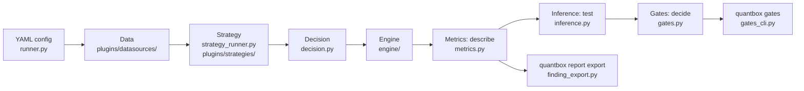

# QuantBox

Quant research and trading framework with a plugin architecture. Config-driven pipelines for backtesting, paper trading, and live execution.

**Not building:** HFT or real-time tick infrastructure, custom exchange gateways, or black-box LLM trading. Math and signals stay deterministic; LLM is for analysis and tool use only.

**Who uses it:**
- **Researcher** — runs research pipelines, adjusts plugins, inspects artifacts
- **Automation** — scheduled jobs producing allocations → orders → fills
- **AI assistant** — calls `validate`, `--dry-run`, `plugins list --json`; no direct trading authority

## Install

```bash
uv add quantbox                # the base install: core only (a client install)
uv add 'quantbox[research]'    # pick the extras you need, or
uv add 'quantbox[full]'        # every extra

# In a clone: uv sync (dev env), or uv sync --extra full
```

The base install carries what the core layer imports, and nothing else
(ADR-0010). Each extra adds one audience's libraries: `[data]`, `[research]`,
`[trade]`, plus `[vectorbt]` and the venue extras. A module that needs a
missing extra raises `MissingExtraError` naming it. `pyproject.toml`
(`dependencies`, `[project.optional-dependencies]`) owns every list.

## Quick start

### Research (fund selection)

```bash
quantbox run -c cookbook/configs/run_fund_selection.yaml
```

### Backtest

```bash
quantbox run -c cookbook/configs/run_backtest_crypto_trend.yaml
```

See [backtesting guide](docs/playbooks/backtesting.md) for engine options and parameters.

### Paper trading

```bash
quantbox run -c cookbook/configs/run_futures_paper_crypto_trend.yaml
```

## Architecture

One run, from config to verdict. Each box names the module that does the step in
`src/quantbox/`; [the audience layers](docs/architecture/README.md) and
[ADR-0008](docs/adr/0008-engine-seam.md) / [ADR-0009](docs/adr/0009-metrics-inference-gates.md) say why it is cut this way.



## Plugins

All plugins are config-driven and discovered automatically. List registered plugins:

```bash
quantbox plugins list
```

The catalogue is `src/quantbox/plugins/manifest.yaml` (`plugins.builtins`), kept
equal to the registry by `tests/pipeline/test_pipeline_smoke.py`; `quantbox plugins
info --name <id>` describes one plugin. No list is copied here — the last one
drifted.

## Plugin manifest and profiles

The bundled manifest defines available profiles:

```yaml
plugins:
  profile: research       # or: trading, trading_full, futures_paper, stress_test
```

Profiles bundle a set of plugins so you don't repeat them in every config.
Override the manifest via `QUANTBOX_MANIFEST=path/to/manifest.yaml`.

## CLI reference

```bash
quantbox plugins list              # list all registered plugins
quantbox plugins list --json       # JSON output
quantbox plugins info --name <id>  # plugin details
quantbox plugins schema --json     # every plugin: id, status, params JSON Schema
quantbox plugins doctor            # health check: schemas, entry points, config refs
quantbox validate -c <config>      # validate config without running
quantbox run -c <config>           # run a pipeline
quantbox run --dry-run -c <config> # dry run (no side effects)
quantbox run --json -c <config>    # print only the run manifest (quantbox/run@1); logs on stderr
quantbox report export <run-or-arms-dir> --format qute-research/finding-report@1 [-o out.json]
        [--extra <line-results>.json] [--benchmark <arm>]
                                   # the data the qute-research finding page renders
quantbox compare <a> <b> [--rtol 1e-9] [--json]
                                   # two JSON files, runs or arms dirs: equal within rtol, the max rel diff and where
quantbox gates dsr|nw --returns <file> --rf dataset:<name>:<column>
                                   # the gate on returns minus a pinned dataset's risk-free column, same dates
quantbox config explain <config> --json  # what a run WOULD do (quantbox/explain@1), nothing simulated
quantbox approve --run-dir <path>  # write approval file for a run's orders
quantbox new line <slug>           # scaffold a pinned research line (docs/playbooks/research-line.md)
quantbox line repin <dir> --ref vX # move a line's quantbox pin, re-derive its exact pins, re-lock
quantbox warehouse tables          # list warehouse tables
quantbox warehouse query -q <sql>  # run SQL against the artifact warehouse
```

## Artifacts

Each run writes to `artifacts/<run_id>/`:
- `run_manifest.json` — the run manifest, schema `quantbox/run@1`: run id, git sha, config sha256,
  engine, dataset, funding, execution timing, venue, `n_trials`, metrics, and `files` — the
  run-dir-relative paths of `returns`, `traded_weights` and `metrics`. Its contract, including the
  versioning rule (adding a field is minor, renaming or re-meaning one is major), is the schema
  [`run_manifest.schema.json`](src/quantbox/artifact_schemas/run_manifest.schema.json); check a
  manifest with `quantbox.run_manifest.validate_run_manifest`. A golden run directory for reader
  tests is [`tests/fixtures/golden_run/`](tests/fixtures/golden_run/).
  `quantbox config explain <config> --json` reports the same fields BEFORE a run, resolved by
  the runner's own code (no data loaded, nothing simulated), under the schema
  [`config_explain.schema.json`](src/quantbox/artifact_schemas/config_explain.schema.json)
  (`quantbox/explain@1`); it exits 1 with the reason when a plugin id or the dataset does not resolve.
- `finding_report.json` — every backtest's slim default report: returns as equity/drawdown,
  the engine's metrics, a per-arm calendar-year robustness grid and the manifest's provenance,
  as `qute-research/finding-report@1` data for the qute-research `/finding-report` page (which
  owns the page and the contract). `quantbox report export` writes the same for a run or a
  directory of arms (each arm's newest run, by the timestamp that ends its run id); a variants
  run's arms come from `variant_returns.parquet` (long: `date, variant, returns`).
  `--extra` takes what only a line's own analysis has, a JSON file the line saved with some of
  `lab`, `kpis`, `metrics`, `robustness`, `audit` and `tables` in the payload's shapes: its
  tables come before the provenance table, each other section replaces the engine's, and series
  and provenance always come from the runs, so a line needs no report adapter of its own.
  Labels are honest (TOM-3764): "Total return" stays the engine's number and the row after it
  is the wealth multiple, `1 + total_return` (303.58 is +30358 % and 304.58x; summary.md and
  report.html print `30358% (304.58x wealth)`); a gate row with a number value and a one-comparator threshold
  gets its pass/fail from that comparison, not from the results file, and shows the comparator
  that holds (`0.829 | < 0.95 | fail`); a `quantbox arms` batch adds a "Fair baseline" table from
  its `arms_summary.json` (the `--benchmark` arm, an `arm/variant` naming its arm, else the one arm whose name says
  bench or buy-and-hold, the same rule that draws the benchmark line).
  The manifest's `reports.finding_report` says whether the run produced it; when the export
  fails, the run's results stand, `produced` is false with the `error`, and `quantbox run`
  prints `FINDING REPORT: NOT PRODUCED` in its summary.
- `report.html` + `report_data.json` — the heavy HTML research report (tens of MB on a typical
  line), written only with `plugins.pipeline.params.full_report: true`.
- `events.jsonl` — structured event log
- Strategy-specific outputs (weights, orders, fills, metrics)

Artifact schemas are bundled at `src/quantbox/artifact_schemas/` and validated at runtime via `importlib.resources`.

## Development

```bash
make dev       # install dev deps
make dev-full  # install all extras + dev deps
pytest -q      # run tests
```

**Broker safety:** start with `readonly: true`, use `--dry-run` to inspect the plan, check `orders.parquet` before enabling live order placement.

See [CLAUDE.md](CLAUDE.md) for agent and LLM development guidelines.

Copy-paste scaffolds for methodology specs, dataset docs, and runbooks are in [`templates/`](templates/).

## Documentation

See [docs/](docs/) for full documentation:
- [Architecture](docs/architecture/README.md) — the audience layers (core, plugins, research, trade) and the two entry styles ([ADR-0010](docs/adr/0010-audience-layers-one-distribution.md))
- [Backtesting guide](docs/playbooks/backtesting.md)
- [Multi-repo workflow](docs/playbooks/multi-repo-workflow.md)
- [Trading bridge](docs/playbooks/trading-bridge.md)
- [Approval gate](docs/playbooks/approval-gate.md)
- [Integration guide](docs/playbooks/quantbox-integration-guide.md)
